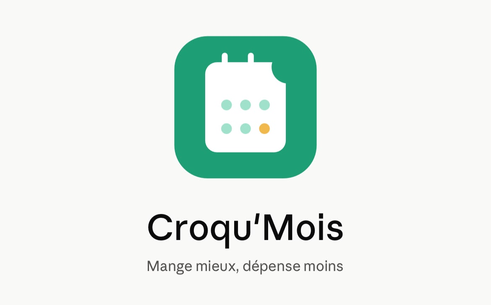

  
   
  <a href="#français">Français</a> | <a href="#english">English</a>

---

# Français

  
L'assistant alimentaire intelligent conçu pour les étudiants, propulsé par l'IA générative.

## 🎯 À propos du projet

Ce projet a été développé dans le cadre du cours **Advanced AI Algorithms (AAA)**.

Les étudiants (18-28 ans) rencontrent des difficultés majeures pour concilier alimentation équilibrée, budget restreint et contraintes matérielles. **Croqu'Mois** dépasse la simple suggestion de recettes en agissant comme un véritable assistant d'organisation. En croisant des données multimodales (budget, emploi du temps, équipements réels, ingrédients restants), l'application génère des plannings sur-mesure et interactifs.

## 🚀 Accès

L'application est déployée et accessible à partir du lien suivant : https://croqu-mois.streamlit.app/.

---

## ✨ Fonctionnalités & Démonstration

### 1. Planification Multicritères
L'utilisateur définit son budget mensuel (réparti dynamiquement à la semaine), ses situations personnelles (période d'examens, prise de masse, fin de mois) et ses équipements (micro-ondes uniquement, plaques, etc.).

  

### 2. Smart Emoji Cards & Liste Interactive
L'IA génère un planning complet et formaté en HTML/CSS, avec des emojis contextuels pour chaque repas. La liste de courses est automatiquement déduite, estimée financièrement et transformée en cases à cocher interactives.

  

### 3. Vision Anti-Gaspillage (Multimodal)
Grâce au modèle de vision par ordinateur, l'étudiant prend en photo les restes de son placard. L'IA identifie les ingrédients et propose instantanément une recette réalisable avec l'équipement dont il dispose.

  

---

# English

  
The intelligent food assistant designed for students, powered by generative AI.

## 🎯 About the project

This project was developed as part of the **Advanced AI Algorithms (AAA)** course.

Students (18-28 years old) face major difficulties in balancing a healthy diet, a tight budget, and material constraints. **Croqu'Mois** goes beyond simple recipe suggestions by acting as a true organizational assistant. By combining multimodal data (budget, schedule, actual equipment, remaining ingredients), the application generates tailored and interactive meal plans.

## 🚀 Access

The application is deployed and accessible at the following link: https://croqu-mois.streamlit.app/.

---

## ✨ Features & Demonstration

### 1. Multi-criteria Planning
The user defines their monthly food budget (dynamically distributed weekly), their personal situations (exam period, bulking, end of month), and their available equipment (microwave only, stove, etc.).

  

### 2. Smart Emoji Cards & Interactive Grocery List
The AI generates a complete meal plan formatted in HTML/CSS, featuring contextual emojis for each meal. The grocery list is automatically deduced, financially estimated, and transformed into interactive checkboxes.

  

### 3. Anti-Waste Vision (Multimodal)
Using the computer vision model, the student takes a picture of the leftovers in their fridge or pantry. The AI identifies the ingredients and instantly proposes a viable recipe based on the equipment they have available.

  

