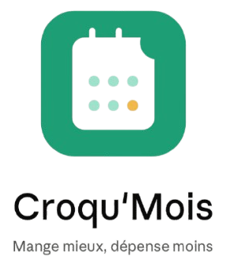
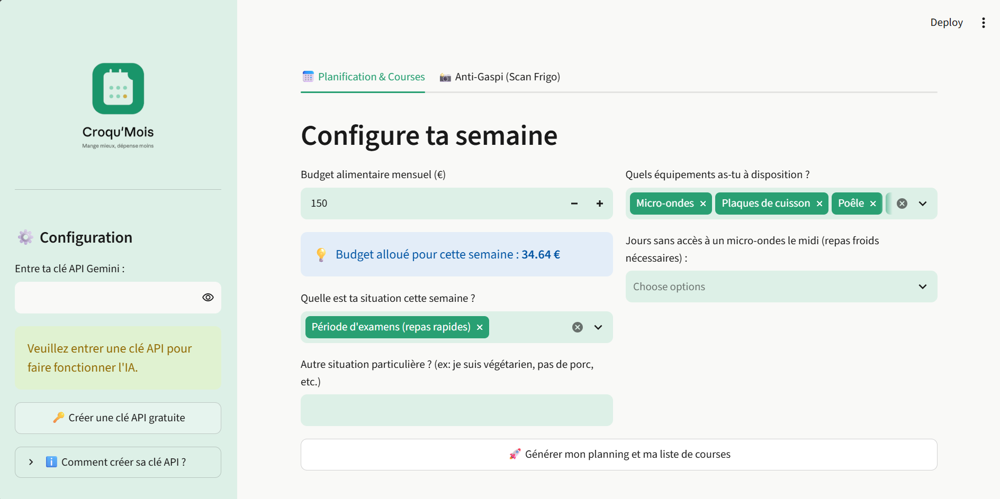
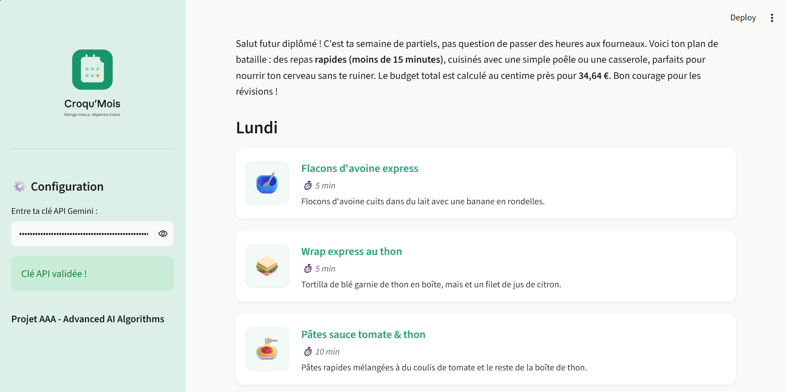
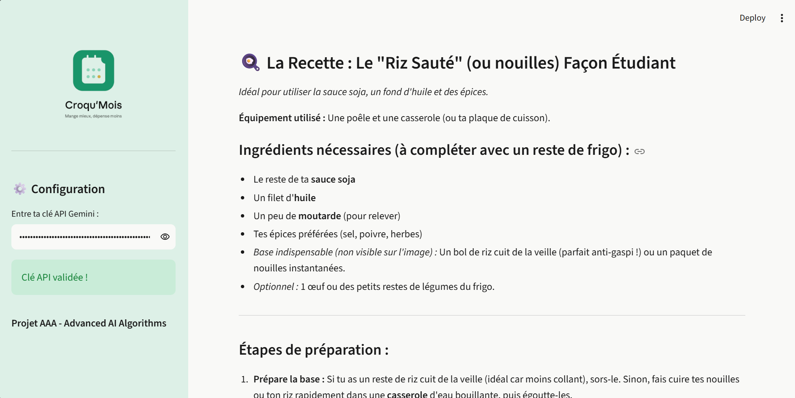

  
  
L'assistant alimentaire intelligent conçu pour les étudiants, propulsé par l'IA générative.

---

## 🎯 À propos du projet

Ce projet a été développé dans le cadre du cours **Advanced AI Algorithms (AAA)**.

Les étudiants (18-28 ans) rencontrent des difficultés majeures pour concilier alimentation équilibrée, budget restreint et contraintes matérielles. **Croqu'Mois** dépasse la simple suggestion de recettes en agissant comme un véritable assistant d'organisation. En croisant des données multimodales (budget, emploi du temps, équipements réels, ingrédients restants), l'application génère des plannings sur-mesure et interactifs.

## ✨ Fonctionnalités & Démonstration

### 1. Planification Multicritères
L'utilisateur définit son budget mensuel (réparti dynamiquement à la semaine), ses situations personnelles (période d'examens, prise de masse, fin de mois) et ses équipements (micro-ondes uniquement, plaques, etc.).

  

### 2. Smart Emoji Cards & Liste Interactive
L'IA génère un planning complet et formaté en HTML/CSS, avec des emojis contextuels pour chaque repas. La liste de courses est automatiquement déduite, estimée financièrement et transformée en cases à cocher interactives.

  

### 3. Vision Anti-Gaspillage (Multimodal)
Grâce au modèle de vision par ordinateur, l'étudiant prend en photo les restes de son placard. L'IA identifie les ingrédients et propose instantanément une recette réalisable avec l'équipement dont il dispose.

  

